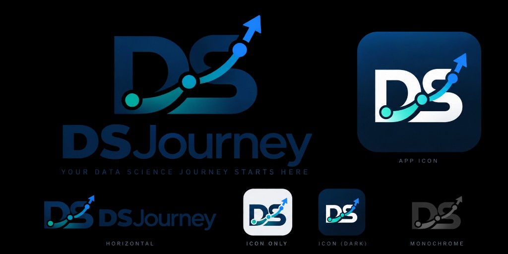
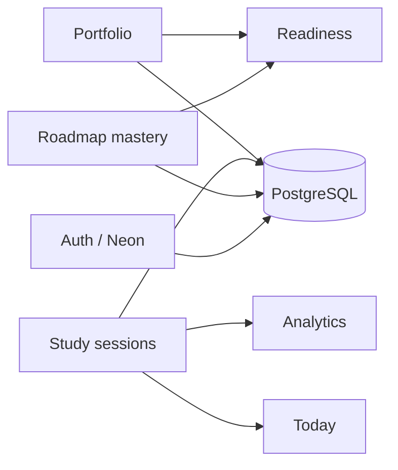

# DSJourney

**Your Data Science career journey — roadmap, study sessions, analytics, readiness, and portfolio in one place.**

[](https://nextjs.org/)
[](https://www.typescriptlang.org/)
[](https://react.dev/)
[](https://tailwindcss.com/)
[](https://dsjourney.vercel.app/)



---

## 60-second pitch

Data Science internship prep spreads across spreadsheets, notes apps, GitHub repos, and half-finished study logs. Roadmap progress, session history, portfolio proof, and readiness signals rarely stay in sync — so it is hard to know what to study next or how close you are to job-ready.

**DSJourney** is a single workspace for that path: track roadmap mastery, log study sessions, review analytics, measure internship readiness, and organize portfolio projects. One Next.js app, Neon PostgreSQL for signed-in data, and Neon Auth for email/password plus Google sign-in.

Roadmap mastery feeds readiness. Study sessions feed analytics and Today. Portfolio projects contribute to readiness. Everything shares one source of truth instead of separate mock pages.

---

## Try it now

**Live demo:** [https://dsjourney.vercel.app/](https://dsjourney.vercel.app/)

Sign in at [/auth](https://dsjourney.vercel.app/auth). Create an account with email (verification required) or use **Continue with Google**.

After sign-in you land on **Today** — your daily command center for stats, recommended next topic, and quick actions.

---

## What makes this different

### 1. Shared roadmap mastery (`src/features/roadmap/`)

Topics move through explicit mastery states:

| State | Meaning |
|-------|---------|
| `not_started` | Not yet touched |
| `learning` | Currently studying |
| `practiced` | Practiced but not confident |
| `mastered` | Confident / complete |

Changes persist through `RoadmapProvider` → Neon (signed-in) with a single catalog in `src/features/roadmap/roadmap-catalog.ts`. Readiness and Today read the same state — not page-local mocks.

### 2. Internship readiness from real progress (`src/features/readiness/`)

Readiness derives from roadmap mastery weights plus portfolio contribution — not hardcoded dashboard numbers. Category breakdown, skill gaps, and recommended focus all pull from shared providers and repositories.

### 3. Study sessions that connect (`src/features/sessions/`)

Sessions log topic, duration, difficulty, and notes. **Analytics**, **Today**, and streak-style summaries derive from the same session store (`SessionProvider` → API → Neon).



---

## App surfaces

### Public

| Route | Purpose |
|-------|---------|
| `/` | Landing — product story, FAQ, sign-up CTA |
| `/auth` | Sign in, sign up, email verification, password reset |
| `/terms`, `/privacy`, `/contact` | Legal and contact |

### Authenticated app

| Route | Purpose |
|-------|---------|
| `/today` | Daily overview — streak, hours, readiness snapshot, next topic |
| `/roadmap` | Topic mastery across DS prep categories |
| `/study-sessions` | Log and review study sessions |
| `/analytics` | Hours, activity, difficulty trends |
| `/readiness` | Internship readiness score and skill gaps |
| `/portfolio` | Projects, skills, recruiter view |
| `/settings` | Account, theme, data export, danger zone |

---

## Tech stack

| Area | Choice |
|------|--------|
| Framework | Next.js 16 (App Router) |
| Language | TypeScript |
| UI | React 19, Tailwind CSS 4, Radix UI, Motion / GSAP |
| Auth | `@neondatabase/auth` (email + Google) |
| Database | Neon PostgreSQL, Drizzle ORM |
| Deploy | Vercel |

---

## Run it locally

```powershell
git clone https://github.com/Rapnunu/ds-prep-tracker.git
cd ds-prep-tracker
git checkout main
npm install
Copy-Item .env.example .env.local
# Fill .env.local with Neon credentials, then:
npm run dev
```

Open [http://localhost:3000](http://localhost:3000).

### Environment variables

Copy `.env.example` → `.env.local`. Never commit secrets.

| Variable | Purpose |
|----------|---------|
| `DATABASE_URL` | Neon PostgreSQL connection string (required) |
| `NEON_AUTH_BASE_URL` | Neon Auth project URL (required for login) |
| `NEON_AUTH_COOKIE_SECRET` | Session cookie signing secret (required) |
| `NEXT_PUBLIC_SITE_URL` | Public URL for canonical links / SEO (recommended in production) |
| `NEXT_PUBLIC_SUPPORT_EMAIL` | Support email on legal/contact pages |
| `TEST_ACCOUNT_EMAIL` | Preview/local only — optional demo login helper |
| `TEST_ACCOUNT_PASSWORD` | Preview/local only — optional demo login helper |

Apply database schema with Drizzle (requires `DATABASE_URL`):

```powershell
npx drizzle-kit push
```

### Deploy on Vercel

1. Import [Rapnunu/ds-prep-tracker](https://github.com/Rapnunu/ds-prep-tracker) into Vercel (Next.js, root `.`).
2. Set production env vars (`DATABASE_URL`, `NEON_AUTH_*`, `NEXT_PUBLIC_SITE_URL`, etc.).
3. Add your Vercel URL to **Neon Auth trusted domains**.
4. Ship from `main`. Confirm `/`, `/auth`, and `/today` after deploy.

Stop `npm run dev` before `npm run build` locally.

Team workflow: [CONTRIBUTING.md](CONTRIBUTING.md).

---

## Repository layout

```
src/
  app/              # App Router pages and API routes
  components/       # Shared UI (auth, landing, layout, theme)
  features/         # Today, Roadmap, Sessions, Analytics, Readiness, Portfolio
  lib/              # Auth, DB, repositories, storage helpers
public/brand/       # Logo and brand assets
drizzle/            # SQL migrations
```

---

## Author

Built by **Raphael Edrian Tan** — personal Data Science internship prep tracker.

- **Live:** [dsjourney.vercel.app](https://dsjourney.vercel.app/)
- **Repository:** [github.com/Rapnunu/ds-prep-tracker](https://github.com/Rapnunu/ds-prep-tracker)

---

_Open the [live demo](https://dsjourney.vercel.app/), sign in, update a roadmap topic, log a study session, and watch Today and Analytics reflect the same data._
